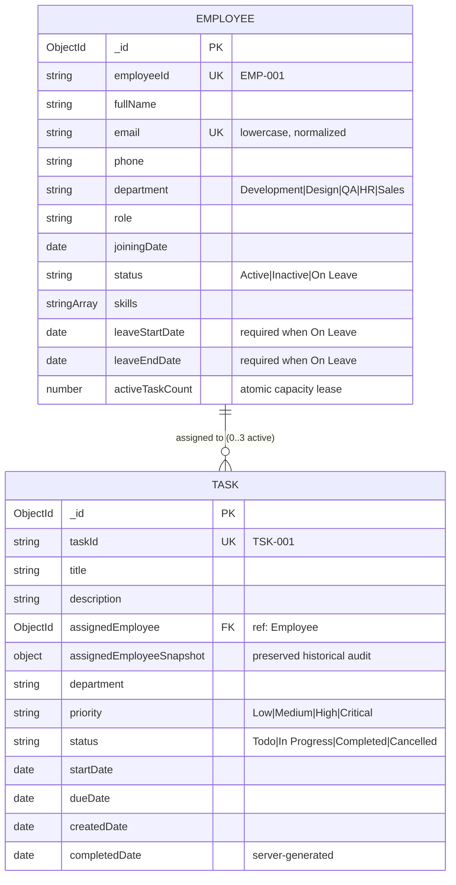

# Roots Media Marketing — Employee & Task Management System
**MERN Stack Developer Technical Practical Assessment**

A production-grade Employee & Task Management System built strictly according to the Roots Media Marketing technical specifications, business rules, API contracts, and UI design references.

---

## 🌟 Project Overview & Key Features

The system manages organizational employees across 5 departments and tracks their assigned tasks through strict lifecycle states.

- **Dashboard**: Live metrics aggregated directly from MongoDB via single-pass `$facet` pipelines (Employee counts by status, Task counts by status, Overdue tasks count, and Ranked Workload capacity table).
- **Employee Directory**: Server-side pagination, text search, department & status filters, multi-field sorting, active task capacity indicators (`x / 3`), and profile management.
- **Task Management**: Lifecycle management from `Todo` $\rightarrow$ `In Progress` $\rightarrow$ `Completed` / `Cancelled`, with auto-generated sequential IDs (`TSK-001`), department routing, priority tags, and overdue tracking.
- **Server-Side CSV Export**: Full-dataset export matching current search and filter criteria across all pagination pages. Fully compliant with RFC 4180, includes UTF-8 BOM (`\uFEFF`) for Excel/Sheets Unicode support, and sanitizes spreadsheet formula injection (CWE-1236).
- **URL-Synchronized Navigation**: Search keywords, filters, sorting, and pagination persist in URL query parameters (e.g. `/tasks?status=In%20Progress&priority=High&page=2`), supporting browser Back/Forward navigation, bookmarking, and page refreshes.
- **Zero-Config Database Fallback**: Built-in automatic in-memory MongoDB fallback if external MongoDB connection credentials are not provided.

---

## 🛠️ Tech Stack & Architecture

### Backend Architecture
- **Runtime**: Node.js (ES Modules)
- **Framework**: Express.js 4.x
- **Database**: MongoDB (Atlas) with Mongoose ODM
- **Testing**: Jest 29, Supertest 7, MongoMemoryServer
- **Logging & Security**: Morgan, CORS, centralized Error Handling middleware (`AppError`), Formula Injection sanitization

### Frontend Architecture
- **Library**: React 19 with Vite 8
- **Routing**: React Router 7 (`BrowserRouter`, `Routes`, `useSearchParams`, `useNavigate`)
- **HTTP Client**: Axios with centralized request/response interceptors and `AbortController` cancellation
- **Styling**: Vanilla CSS Design System with CSS Custom Properties, flexbox/grid responsive layouts, and accessible modals

---

## 🚀 Prerequisites & Local Setup

### Prerequisites
- **Node.js**: v18.0.0 or higher (v20+ recommended)
- **npm**: v9.0.0 or higher
- **MongoDB**: MongoDB Atlas URI (or runs automatically via in-memory MongoDB fallback)

### Installation
From the root workspace:
```bash
# Install dependencies for root, backend, and frontend
npm run install:all
```

### Environment Configuration
Copy the provided `.env.example` templates:
```bash
cp .env.example .env
cp backend/.env.example backend/.env
cp frontend/.env.example frontend/.env
```

### Running the Application Locally
Open two terminal windows (or run concurrent scripts):

```bash
# Terminal 1: Backend Server (runs on http://localhost:5001)
npm run backend

# Terminal 2: Frontend Client (runs on http://localhost:5173)
npm run frontend
```

On first launch, if the database is empty, the server **automatically seeds 12 employees and 40 tasks** matching the technical specification mockup dataset.

---

## 🔐 Environment Variables

### Root / Backend (`backend/.env`)
| Variable | Description | Default / Example |
| :--- | :--- | :--- |
| `PORT` | Backend HTTP port | `5001` |
| `NODE_ENV` | Runtime environment (`development` / `production` / `test`) | `development` |
| `MONGODB_URI` | MongoDB Atlas or hosted database connection string | `mongodb+srv://<user>:<password>@cluster.mongodb.net/roots_management` |
| `CLIENT_URL` | Allowed frontend origin(s) for CORS (comma-separated) | `http://localhost:5173,https://your-frontend.vercel.app` |

### Frontend (`frontend/.env`)
| Variable | Description | Default / Example |
| :--- | :--- | :--- |
| `VITE_API_BASE_URL` | Base API URL prefix for backend communication | `/api` (uses Vite proxy locally, set to cloud URL in production) |

---

## 🗄️ Database Schemas & Entity Relationships



### Hybrid Reference + Snapshot Relationship
To fulfill the requirement that deleting an employee must not produce broken references or lose historical task accountability:
1. `assignedEmployee`: Mongoose `ObjectId` (`ref: 'Employee'`) used for queries, workload aggregation, and capacity tracking.
2. `assignedEmployeeSnapshot`: An immutable subdocument embedded into every task containing `fullName`, `employeeId`, `email`, and `department`.
- Deleting an employee with active tasks (`Todo` or `In Progress`) is **strictly blocked** (`400 Bad Request`).
- When an employee with only terminal (`Completed`/`Cancelled`) tasks is deleted, the historical tasks retain their embedded snapshot, ensuring audit trails remain intact forever.

---

## 📋 Comprehensive Technical Evaluation Questions

### 1. Where task status transitions are validated and why
**Where:**
Validated exclusively in the backend service layer ([backend/services/taskStateService.js](file:///Users/vanshkesarwanii/Desktop/roots-management-system/backend/services/taskStateService.js)) via a dedicated endpoint `PUT /api/tasks/:id/status`. The general update endpoint (`PUT /api/tasks/:id`) explicitly strips out and ignores status changes.

**Why:**
Client-side validation can be bypassed by inspecting network requests, using cURL, or modifying client state. The backend is the single authoritative source of truth. Allowed transitions follow a strict state machine:
- `Todo` $\rightarrow$ `In Progress`
- `Todo` $\rightarrow$ `Cancelled`
- `In Progress` $\rightarrow$ `Completed`
- `In Progress` $\rightarrow$ `Cancelled`

Any other transition (e.g. `Todo` $\rightarrow$ `Completed`, reviving `Completed` $\rightarrow$ `In Progress`, or modifying `Cancelled`) is rejected with `400 Bad Request`.

---

### 2. Why Completed Date comes from the backend
**Why:**
Client device clocks are untrusted, prone to timezone skew, incorrect manual system time, or malicious tampering. Allowing the frontend to supply `completedDate` ruins audit integrity. The server generates `new Date()` automatically at the exact millisecond the task status transitions to `Completed`.

---

### 3. How inactive and on-leave employee assignments are blocked
**How:**
Implemented in [backend/services/taskService.js](file:///Users/vanshkesarwanii/Desktop/roots-management-system/backend/services/taskService.js) (`validateAssignmentEligibility`):
1. **Inactive Employees**: If `employee.status === 'Inactive'`, assignment is rejected unconditionally with `400 Bad Request` (*"Tasks can only be given to Active employees"*).
2. **On Leave Employees**: If `employee.status === 'On Leave'`, the backend checks the task's `startDate` against the employee's scheduled leave dates normalized to UTC midnight:
   $$\text{leaveStartDate} \le \text{startDate} \le \text{leaveEndDate} \quad \text{(inclusive)}$$
   - If the task start date falls inside this window, the assignment is rejected with `400 Bad Request`.
   - If the task start date falls strictly outside the leave window, assignment is permitted.

---

### 4. Why filtering and pagination run on the backend
**Why:**
1. **Network Performance**: In production with thousands of records, fetching the entire database into React would transmit megabytes of JSON over the wire, causing sluggish load times and mobile browser memory crashes.
2. **Database Indexing**: MongoDB utilizes B-Tree indexes on `{ department: 1, status: 1 }` and `{ status: 1, dueDate: 1 }` to execute filtering, sorting, and pagination in sub-millisecond time.
3. **Data Accuracy**: Backend queries return live database state rather than operating on a stale in-memory array.

---

### 5. Why filters live in the URL
**Why:**
1. **Shareability & Deep Linking**: Users can copy `/tasks?status=In%20Progress&priority=High&page=2` and send it to team members, who land on the exact same filtered and paginated view.
2. **Browser History**: Pressing Back and Forward buttons moves between filter steps naturally.
3. **Refresh Persistence**: Reloading the page does not wipe user selections.
4. **CSV Export Parity**: The CSV export reads active URL parameters to ensure the downloaded dataset matches what the user is inspecting on screen.

---

### 6. What can go wrong with concurrent fourth-task assignments and how it is prevented
**The Problem (TOCTOU Race Condition):**
If an employee currently has 2 active tasks (`Todo` + `In Progress`), and two concurrent HTTP requests (A and B) attempt to assign a 3rd task simultaneously:
1. Request A counts active tasks $\rightarrow$ gets 2 ($2 < 3 \rightarrow$ OK).
2. Request B counts active tasks $\rightarrow$ gets 2 ($2 < 3 \rightarrow$ OK).
3. Request A writes task $\rightarrow$ active tasks = 3.
4. Request B writes task $\rightarrow$ active tasks = 4 (**Violates capacity business rule!**).

**Our Prevention Strategy:**
We execute an atomic conditional lease operation directly in MongoDB:
```javascript
const updatedEmp = await Employee.findOneAndUpdate(
  { _id: employee._id, activeTaskCount: { $lt: 3 } },
  { $inc: { activeTaskCount: 1 } },
  { new: true }
);
if (!updatedEmp) {
  throw new AppError('Employee has reached maximum capacity of 3 active tasks.', 400);
}
```
If the employee is at 3 tasks, `findOneAndUpdate` returns `null` atomically. This is verified in our concurrency stress test (`tests/businessRules.test.js`) using `Promise.all()` with simultaneous parallel requests.

---

## 📡 REST API Reference & Examples

### 1. Employee Endpoints
- `GET /api/employees`: List employees with search, department, status, sort, and pagination.
- `POST /api/employees`: Register a new employee (validates duplicate ID & email).
- `GET /api/employees/:id`: View employee profile with active workload and task history.
- `PUT /api/employees/:id`: Edit employee details (employeeId is immutable).
- `DELETE /api/employees/:id`: Delete employee (blocked if employee has active tasks).

#### Example: Create Employee
```http
POST /api/employees HTTP/1.1
Content-Type: application/json

{
  "employeeId": "EMP-013",
  "fullName": "Sunil Kumar",
  "email": "sunil.kumar@rootsmedia.com",
  "phone": "+91 98888 77777",
  "department": "Development",
  "role": "Backend Engineer",
  "joiningDate": "2026-01-15",
  "status": "Active",
  "skills": ["Node.js", "Express", "MongoDB"]
}
```

### 2. Task Endpoints
- `GET /api/tasks`: List tasks with search, department, priority, status, dueFrom, dueTo, sortBy, sortOrder, page, limit.
- `POST /api/tasks`: Create task (initial status is always `Todo`, enforces capacity $\le 3$).
- `GET /api/tasks/:id`: Task details with overdue status and assigned employee.
- `PUT /api/tasks/:id`: Edit task (blocked for `Completed` or `Cancelled` tasks).
- `DELETE /api/tasks/:id`: Delete task.
- `PUT /api/tasks/:id/status`: Advance status (`Todo` $\rightarrow$ `In Progress` $\rightarrow$ `Completed` / `Cancelled`).
- `GET /api/tasks/export/csv`: Download CSV of all matching records across filters.

#### Example: Change Task Status
```http
PUT /api/tasks/6acf610d21c1e4290bcc3ba8/status HTTP/1.1
Content-Type: application/json

{
  "status": "In Progress"
}
```

### 3. Dashboard Endpoints
- `GET /api/dashboard`: Live MongoDB aggregation statistics for employee counts, task counts, overdue counts, and ranked employee workload.
- `GET /api/health`: Health status, server uptime, and timestamp.

---

## 🧪 Automated Testing

Run the unified test suite executing all backend and frontend tests:
```bash
npm test
```

### Individual Test Suites
```bash
# Run backend test suites (86 test cases in Jest)
npm run test:backend

# Run frontend test suites (12 test cases in Vitest)
npm run test:frontend

# Run linter across backend and frontend (0 errors)
npm run lint

# Run production bundle build
npm run build
```

---

## 🚢 Deployment Guide

### Option A: Frontend Deployment (Vercel)
1. Push project to GitHub.
2. In the Vercel Dashboard, import the repository.
3. Configure settings:
   - **Root Directory**: `frontend`
   - **Framework Preset**: `Vite`
   - **Build Command**: `npm run build`
   - **Output Directory**: `dist`
4. Environment Variables:
   - `VITE_API_BASE_URL`: `https://your-backend-service.onrender.com/api`
5. Click **Deploy**. SPA client-side routing is handled via `frontend/vercel.json`.

### Option B: Backend Deployment (Render / Railway)
1. In the Render / Railway Dashboard, create a **Web Service**.
2. Connect the repository.
3. Configure settings:
   - **Root Directory**: `backend` (or root with start script)
   - **Build Command**: `npm install`
   - **Start Command**: `node server.js`
4. Set Environment Variables:
   - `PORT`: `5001`
   - `NODE_ENV`: `production`
   - `MONGODB_URI`: `mongodb+srv://<user>:<password>@cluster0.example.mongodb.net/roots_management`
   - `CLIENT_URL`: `https://your-frontend-app.vercel.app`
5. Click **Deploy**.

---

## ⚠️ Known Limitations & Assumptions

1. **Authentication**: Per assignment specifications, user authentication and authorization are not required. All API endpoints and dashboard views remain open for evaluation.
2. **Employee ID Immutability**: `employeeId` cannot be changed after creation to maintain stable historical task snapshots.
3. **Sequential Task IDs**: `taskId` uses an atomic sequence counter (`Counter` collection) resulting in clean human-readable IDs (`TSK-001`). If a task is permanently deleted, its sequence number is not recycled to preserve chronological integrity.

---

## ✅ Final Assignment Requirement Checklist

| Requirement | Implementation Verification | Status |
| :--- | :--- | :---: |
| Employee Model & Validations | [`modelValidation.test.js`](file:///Users/vanshkesarwanii/Desktop/roots-management-system/backend/tests/modelValidation.test.js) | **PASSED** |
| Task Model & Auto Task ID | [`modelValidation.test.js`](file:///Users/vanshkesarwanii/Desktop/roots-management-system/backend/tests/modelValidation.test.js) | **PASSED** |
| Employee CRUD APIs | [`employeeCrud.test.js`](file:///Users/vanshkesarwanii/Desktop/roots-management-system/backend/tests/employeeCrud.test.js) | **PASSED** |
| Unique Email & Employee ID (409) | [`employeeCrud.test.js`](file:///Users/vanshkesarwanii/Desktop/roots-management-system/backend/tests/employeeCrud.test.js) | **PASSED** |
| Block Deletion of Employees with Active Tasks | [`employeeCrud.test.js`](file:///Users/vanshkesarwanii/Desktop/roots-management-system/backend/tests/employeeCrud.test.js) | **PASSED** |
| Historical Task Employee Snapshot | [`businessRules.test.js`](file:///Users/vanshkesarwanii/Desktop/roots-management-system/backend/tests/businessRules.test.js) | **PASSED** |
| Inactive & On-Leave Assignment Rules | [`businessRules.test.js`](file:///Users/vanshkesarwanii/Desktop/roots-management-system/backend/tests/businessRules.test.js) | **PASSED** |
| Due Date $\ge$ Start Date Validation | [`modelValidation.test.js`](file:///Users/vanshkesarwanii/Desktop/roots-management-system/backend/tests/modelValidation.test.js) | **PASSED** |
| Status State Machine (Only Allowed Transitions) | [`businessRules.test.js`](file:///Users/vanshkesarwanii/Desktop/roots-management-system/backend/tests/businessRules.test.js) | **PASSED** |
| Server-Generated Completed Date | [`businessRules.test.js`](file:///Users/vanshkesarwanii/Desktop/roots-management-system/backend/tests/businessRules.test.js) | **PASSED** |
| Completed/Cancelled Task Immutability | [`businessRules.test.js`](file:///Users/vanshkesarwanii/Desktop/roots-management-system/backend/tests/businessRules.test.js) | **PASSED** |
| 3-Active-Task Workload Capacity | [`businessRules.test.js`](file:///Users/vanshkesarwanii/Desktop/roots-management-system/backend/tests/businessRules.test.js) | **PASSED** |
| Concurrent Assignment Concurrency Protection | [`businessRules.test.js`](file:///Users/vanshkesarwanii/Desktop/roots-management-system/backend/tests/businessRules.test.js) | **PASSED** |
| Overdue Consistency Rule | [`dashboardAndExport.test.js`](file:///Users/vanshkesarwanii/Desktop/roots-management-system/backend/tests/dashboardAndExport.test.js) | **PASSED** |
| Dashboard Live Aggregations ($facet) | [`dashboardAndExport.test.js`](file:///Users/vanshkesarwanii/Desktop/roots-management-system/backend/tests/dashboardAndExport.test.js) | **PASSED** |
| Full-Dataset CSV Export (RFC 4180 & CWE-1236) | [`dashboardAndExport.test.js`](file:///Users/vanshkesarwanii/Desktop/roots-management-system/backend/tests/dashboardAndExport.test.js) | **PASSED** |
| URL Query Param Synchronization & Navigation | [`urlSyncAndFilters.test.js`](file:///Users/vanshkesarwanii/Desktop/roots-management-system/backend/tests/urlSyncAndFilters.test.js), [`urlParams.test.js`](file:///Users/vanshkesarwanii/Desktop/roots-management-system/frontend/src/tests/urlParams.test.js) | **PASSED** |
| Stale Response & Race Protection (AbortController) | [`TaskListPage.jsx`](file:///Users/vanshkesarwanii/Desktop/roots-management-system/frontend/src/pages/tasks/TaskListPage.jsx) | **PASSED** |
| Complete Responsive React UI (9 pages) | Verified with Vite production build & 0 lint errors | **PASSED** |
